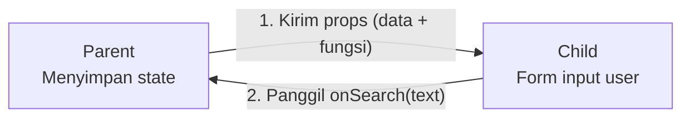

# Modul 5 - Fundamental React dengan TypeScript

> Stack: **React 19 + TypeScript + Vite** (terhubung dengan API Express dari **Modul 4**)

<div align="center">
  
</div>

---

## Daftar Isi

1. [Tujuan Pembelajaran &amp; Prasyarat](#1-tujuan-pembelajaran--prasyarat)
2. [Gambaran Besar: Kenapa Butuh React?](#2-gambaran-besar-kenapa-butuh-react)
3. [Inisiasi Project (Vite + TypeScript)](#3-inisiasi-project-vite--typescript)
4. [JSX / TSX: Markup di dalam TypeScript](#4-jsx--tsx-markup-di-dalam-typescript)
5. [Component &amp; Props](#5-component--props)
6. [Conditional Rendering &amp; List Rendering](#6-conditional-rendering--list-rendering)
7. [Event Handling &amp; `useState`](#7-event-handling--usestate)
8. [Form &amp; Lifting State Up](#8-form--lifting-state-up)
9. [Side Effects &amp; `useEffect`](#9-side-effects--useeffect)
10. [Fetch API &amp; Integrasi Backend Modul 4](#10-fetch-api--integrasi-backend-modul-4)
11. [`useRef` Dasar &amp; Pengantar Custom Hook](#11-useref-dasar--pengantar-custom-hook)
12. [Struktur Folder yang Rapi](#12-struktur-folder-yang-rapi)
13. [Jebakan Umum &amp; Troubleshooting](#13-jebakan-umum--troubleshooting)
14. [Challenge Praktikum](#14-challenge-praktikum)
15. [Cheatsheet &amp; Referensi](#15-cheatsheet--referensi)

---

## 1. Tujuan Pembelajaran & Prasyarat

Setelah mengikuti modul ini, kalian diharapkan mampu:

- Menjelaskan perbedaan manipulasi DOM manual (Modul 2) dan pendekatan **deklaratif** di React.
- Memecah tampilan menjadi **Component** yang menerima **Props** bertipe TypeScript.
- Mengelola data interaktif dengan **`useState`** (termasuk update array/object secara *immutable* dan *controlled form*).
- Mengambil data dari REST API memakai **`useEffect` + `fetch`** dan menampilkannya ke UI.

### Prasyarat

| Kebutuhan                                                     | Keterangan                                                      |
| :------------------------------------------------------------ | :-------------------------------------------------------------- |
| **Node.js**                                             | Versi **24 LTS** atau **26** (sama seperti Modul 4) |
| **HTML, CSS, Array `.map`/`.filter`, `fetch`**    | Materi Modul 1 & Modul 2                                        |
| **TypeScript (`interface`, `type`, import/export)** | Materi Modul 3                                                  |
| **Backend Express (Opsional untuk integrasi)**          | Project Modul 4 (atau gunakan data *mock* lokal)              |

---

## 2. Gambaran Besar: Kenapa Butuh React?

Di **Modul 2**, kalian mengubah tampilan dengan memanggil `document.getElementById()`, lalu mengubah `.textContent`, `.innerHTML`, atau `.classList` satu per satu. Saat aplikasi membesar, kita mudah lupa memperbarui salah satu elemen sehingga data dan tampilan tidak sinkron.

Di **React**, kita cukup **mengubah data (`state`)**, lalu React otomatis menghitung dan memperbarui bagian tampilan yang berubah (**UI = fungsi dari State**).

<div align="center">
  
</div>

| Aspek                    | Vanilla JS (Modul 2)                                      | React (Modul 5)                                                                          |
| :----------------------- | :-------------------------------------------------------- | :--------------------------------------------------------------------------------------- |
| **Cara kerja**     | **Imperatif**: perintah langkah demi langkah ke DOM | **Deklaratif**: cukup tulis tampilan untuk setiap kondisi state                    |
| **Pemecahan kode** | HTML, CSS, dan JS terpisah per halaman                    | Dipecah per **Component** kecil yang bisa dipakai ulang (*reusable*)             |
| **Arsitektur**     | Multi-page / manipulasi manual                            | **SPA (Single Page Application)**: 1 `index.html`, isi berganti dinamis lewat JS |

---

## 3. Inisiasi Project (Vite + TypeScript)

Kita pakai **Vite** (build tool modern yang cepat) dengan template React + TypeScript:

```bash
npm create vite@latest belajar-react -- --template react-ts
cd belajar-react
npm install
npm run dev
```

Buka URL yang muncul di terminal (biasanya `http://localhost:5173`).

### Struktur Awal yang Penting

```text
belajar-react/
├── index.html        # Satu-satunya file HTML, punya <div id="root"></div>
├── package.json
└── src/
    ├── main.tsx      # Titik masuk: menyuntikkan <App /> ke dalam #root
    ├── App.tsx       # Komponen utama aplikasi kita
    └── index.css     # CSS global sederhana (melanjutkan CSS Modul 1)
```

> [!NOTE]
> Cukup edit file di dalam `src/`. Setiap kali file disimpan, Vite langsung memperbarui tampilan di browser tanpa *refresh* penuh (*Hot Module Replacement*).

---

## 4. JSX / TSX: Markup di dalam TypeScript

**TSX** adalah sintaks yang membolehkan kita menulis tag mirip HTML langsung di dalam file `.tsx`. Ada 4 aturan wajib dibanding HTML biasa (Modul 1):

| Aturan                                  | HTML (Modul 1)                              | JSX / TSX (React)                                      |
| :-------------------------------------- | :------------------------------------------ | :----------------------------------------------------- |
| **1. Satu pembungkus (*Root*)** | Bebas banyak tag sejajar                    | Wajib dibungkus 1 tag induk atau Fragment `<>...</>` |
| **2. Tutup semua tag**            | `<input>` atau `<br>` boleh tanpa tutup | Wajib ditutup: `<input />`, `<br />`, ``  |
| **3. Nama atribut camelCase**     | `class="..."`, `for="..."`              | `className="..."`, `htmlFor="..."`                 |
| **4. Sisipkan kode JS/TS**        | Tidak bisa langsung                         | Pakai kurung kurawal `{variabel}` atau `{1 + 1}`   |

```tsx
function Salam() {
  const nama = "Budi";
  return (
    <>
      <h1 className="judul">Halo, {nama}!</h1>
      <p>Belajar React di tahun {2025 + 1}</p>
    </>
  );
}
```

---

## 5. Component & Props

**Component** adalah fungsi TypeScript yang namanya diawali **Huruf Kapital** dan mengembalikan TSX. **Props** adalah "parameter" yang dikirim dari komponen *Parent* ke *Child* (sifatnya **read-only**, tidak boleh diubah di dalam *Child*).

<div align="center">
  
</div>

Gunakan `interface` (materi **Modul 3**) untuk mendefinisikan bentuk props agar TypeScript langsung menegur jika ada prop yang kurang atau salah tipe:

```tsx
// src/components/PostCard.tsx
interface PostCardProps {
  title: string;
  author: string;
  views?: number; // opsional
}

export function PostCard({ title, author, views = 0 }: PostCardProps) {
  return (
    <article className="card">
      <h3>{title}</h3>
      <p>Penulis: {author} • {views} kali dilihat</p>
    </article>
  );
}
```

Pemakaian di `App.tsx`:

```tsx
import { PostCard } from "./components/PostCard";

export default function App() {
  return (
    <main>
      <PostCard title="Belajar React" author="Budi" views={12} />
      <PostCard title="Mengenal Prisma" author="Siti" />
    </main>
  );
}
```

### Prop Spesial: `children`

Gunakan `children: React.ReactNode` jika ingin membuat komponen pembungkus (*wrapper*) seperti `<Card>...</Card>`:

```tsx
interface BoxProps {
  children: React.ReactNode;
}

function Box({ children }: BoxProps) {
  return <div className="box">{children}</div>;
}

// Pemakaian: <Box><p>Isi bebas di dalam sini</p></Box>
```

---

## 6. Conditional Rendering & List Rendering

### Conditional Rendering

Tampilkan UI berdasarkan kondisi menggunakan **ternary (`? :`)**, **operator `&&`**, atau ***early return***:

```tsx
function StatusBadge({ published }: { published: boolean }) {
  return (
    <span>{published ? "Terbit" : "Draft"}</span>
  );
}

// Tampil hanya jika kondisi true
{isLoading && <p>Memuat data...</p>}
```

> [!WARNING]
> Hindari `{items.length && <List />}` karena jika `items.length` bernilai `0`, angka `0` akan tercetak di layar. Tulis `{items.length > 0 && <List />}`.

### List Rendering dengan `.map()` & `key`

Sama seperti di Modul 2, ubah array data menjadi array komponen memakai `.map()`. Setiap item **wajib** diberi prop `key` yang unik (sebaiknya `id` data, bukan index array agar React tidak bingung saat data ditambah/dihapus).

```tsx
interface Post {
  id: number;
  title: string;
  author: string;
}

const posts: Post[] = [
  { id: 1, title: "Intro React", author: "Budi" },
  { id: 2, title: "Express + Neon", author: "Siti" },
];

export default function App() {
  return (
    <div>
      {posts.map((post) => (
        <PostCard key={post.id} title={post.title} author={post.author} />
      ))}
    </div>
  );
}
```

---

## 7. Event Handling & `useState`

Variabel `let` biasa tidak akan mengubah tampilan layar meskipun nilainya bertambah, karena React tidak tahu kapan harus menggambar ulang komponen. Untuk data yang bisa berubah oleh interaksi user, gunakan Hook **`useState`**.

<div align="center">
  
</div>

```tsx
import { useState } from "react";

export function Counter() {
  const [count, setCount] = useState(0); // [nilaiSaatIni, fungsiPengubah]

  return (
    <button onClick={() => setCount(count + 1)}>
      Diklik {count} kali
    </button>
  );
}
```

### Aturan Emas `useState` untuk Array & Object (Immutability)

**Jangan pernah memutasi state secara langsung** (seperti `todos.push(...)`), karena React membandingkan referensi objeknya. Selalu buat salinan baru memakai *spread operator* `...`, `.filter()`, atau `.map()`:

| Operasi               | Jangan Dilakukan (Mutasi) | Cara Benar di React (Immutable)                                                    |
| :-------------------- | :------------------------ | :--------------------------------------------------------------------------------- |
| **Tambah item** | `items.push(baru)`      | `setItems([...items, baru])`                                                     |
| **Hapus item**  | `items.splice(idx, 1)`  | `setItems(items.filter((item) => item.id !== id))`                               |
| **Ubah item**   | `items[0].done = true`  | `setItems(items.map((item) => item.id === id ? { ...item, done: true } : item))` |

---

## 8. Form & Lifting State Up

### Controlled Form

Di React, nilai `<input>` dikendalikan oleh `useState` lewat prop `value` dan `onChange`. Event form diberi tipe `React.FormEvent` (untuk submit) dan `React.ChangeEvent<HTMLInputElement>` (untuk input).

```tsx
import { useState } from "react";

export function SearchBar({ onSearch }: { onSearch: (keyword: string) => void }) {
  const [text, setText] = useState("");

  const handleSubmit = (e: React.FormEvent) => {
    e.preventDefault(); // Mencegah browser reload (sama seperti Modul 2)
    onSearch(text);     // Kirim data ke Parent (Lifting State Up)
    setText("");
  };

  return (
    <form onSubmit={handleSubmit}>
      <input
        value={text}
        onChange={(e) => setText(e.target.value)}
        placeholder="Cari judul..."
      />
      <button type="submit">Cari</button>
    </form>
  );
}
```

### Lifting State Up (Komunikasi Child → Parent)

Props hanya mengalir **turun** (*Parent → Child*). Jika *Child* ingin mengirim data ke *Parent* (atau berbagi state antar dua komponen sejajar), taruh `useState`-nya di *Parent*, lalu kirim fungsi *callback* lewat props seperti `onSearch` di atas:



---

## 9. Side Effects & `useEffect`

Komponen React seharusnya hanya fokus menghitung JSX dari props & state. Jika kita perlu melakukan hal di luar itu (**Side Effect**)—seperti memanggil API (`fetch`), mengatur `setInterval`, atau membaca `localStorage`—letakkan di dalam **`useEffect`**.

<div align="center">
  
</div>

| Bentuk Penulisan                    | Kapan Dijalankan?                                                   | Contoh Kegunaan                                |
| :---------------------------------- | :------------------------------------------------------------------ | :--------------------------------------------- |
| `useEffect(fn, [])`               | **Sekali saja** saat komponen pertama kali muncul (*mount*) | `fetch` data awal halaman                    |
| `useEffect(fn, [search])`         | Saat *mount* **dan setiap kali** `search` berubah         | `fetch` ulang sesuai kata kunci pencarian    |
| `useEffect(fn)` *(tanpa array)* | Setiap kali komponen *re-render*                                  | Jarang dipakai (rawan bikin *infinite loop*) |

```tsx
useEffect(() => {
  const timer = setInterval(() => console.log("Detik berjalan"), 1000);

  // Cleanup: wajib bersihkan timer/listener saat komponen hilang
  return () => clearInterval(timer);
}, []);
```

---

## 10. Fetch API & Integrasi Backend Modul 4

Di Modul 4, API Express kalian mengembalikan JSON berbentuk `{ status, message, data, metadata }`. Di React, pola standar mengambil API selalu memakai 3 state: **`data`**, **`isLoading`**, dan **`error`**.

<div align="center">
  
</div>

### Langkah Kecil di Backend Modul 4: Aktifkan CORS

Karena React berjalan di port `5173` dan Express di port `3000`, browser memblokir request jika backend belum mengizinkan *origin* React. Di folder backend Modul 4:

```bash
npm install cors
npm install -D @types/cors
```

Tambahkan di `src/index.ts` (di atas `app.use("/api", router)`):

```typescript
import cors from "cors";
app.use(cors({ origin: "http://localhost:5173" }));
```

### Contoh Fetch Data di React

```tsx
import { useEffect, useState } from "react";

interface Post {
  id: number;
  title: string;
  content: string | null;
  author: { id: number; name: string | null };
}

export function PostList() {
  const [posts, setPosts] = useState<Post[]>([]);
  const [isLoading, setIsLoading] = useState(true);
  const [error, setError] = useState<string | null>(null);

  useEffect(() => {
    const loadPosts = async () => {
      try {
        const res = await fetch("http://localhost:3000/api/posts");
        if (!res.ok) throw new Error("Gagal mengambil data");
        const json = await res.json();
        setPosts(json.data); // Sesuai format sendSuccess() di Modul 4
      } catch (err) {
        setError(err instanceof Error ? err.message : "Terjadi kesalahan");
      } finally {
        setIsLoading(false);
      }
    };
    loadPosts();
  }, []);

  if (isLoading) return <p>Memuat posts...</p>;
  if (error) return <p>Error: {error}</p>;
  if (posts.length === 0) return <p>Belum ada post.</p>;

  return (
    <div>
      {posts.map((post) => (
        <PostCard
          key={post.id}
          title={post.title}
          author={post.author?.name ?? "Anonim"}
        />
      ))}
    </div>
  );
}
```

> [!NOTE]
> Jika kalian mengerjakan praktikum tanpa menyalakan server Modul 4, endpoint `https://jsonplaceholder.typicode.com/posts?_limit=5` bisa dipakai sementara untuk berlatih `fetch` (sesuaikan interface `Post`-nya).

---

## 11. `useRef` Dasar & Pengantar Custom Hook

### `useRef`: Referensi DOM & Nilai Tanpa Re-render

| Hook                   | Memicu Re-render saat berubah? | Contoh Penggunaan                                                       |
| :--------------------- | :----------------------------: | :---------------------------------------------------------------------- |
| **`useState`** |               Ya               | Teks input, daftar post, status loading                                 |
| **`useRef`**   |        **Tidak**        | Memfokuskan `<input>` secara langsung (`inputRef.current?.focus()`) |

```tsx
import { useRef } from "react";

export function FocusInput() {
  const inputRef = useRef<HTMLInputElement>(null);

  return (
    <>
      <input ref={inputRef} placeholder="Klik tombol untuk fokus" />
      <button onClick={() => inputRef.current?.focus()}>Fokuskan</button>
    </>
  );
}
```

### Pengantar Custom Hook

Jika logika `useState` + `useEffect` (misalnya simpan ke `localStorage`) dipakai di banyak komponen, ekstrak ke fungsi terpisah yang namanya **wajib diawali `use`**, contoh: `useLocalStorage`:

```tsx
// src/hooks/useLocalStorage.ts
import { useEffect, useState } from "react";

export function useLocalStorage<T>(key: string, initialValue: T) {
  const [value, setValue] = useState<T>(() => {
    const saved = localStorage.getItem(key);
    return saved ? (JSON.parse(saved) as T) : initialValue;
  });

  useEffect(() => {
    localStorage.setItem(key, JSON.stringify(value));
  }, [key, value]);

  return [value, setValue] as const;
}
```

---

## 12. Struktur Folder yang Rapi

Melanjutkan kebiasaan memisahkan tipe dari **Modul 3**, jangan tumpuk semua komponen di `App.tsx`. Bagi menjadi folder yang jelas:

```text
src/
├── components/        # Komponen UI kecil (PostCard.tsx, PostForm.tsx)
├── hooks/             # Custom hooks (useLocalStorage.ts)
├── services/          # Fungsi fetch ke API (postService.ts)
├── types/             # Interface & type TypeScript (post.ts)
├── App.tsx            # Merangkai komponen & state utama
└── main.tsx
```

---

## 13. Jebakan Umum & Troubleshooting

| Gejala / Error                                                          | Penyebab Umum                                                                        | Solusi                                                                             |
| :---------------------------------------------------------------------- | :----------------------------------------------------------------------------------- | :--------------------------------------------------------------------------------- |
| Layar blank / tab browser hang (*infinite loop*)                      | Memanggil `setState` langsung di dalam `useEffect` tanpa dependency array `[]` | Tambahkan `[]` atau dependency spesifik `[id]` di argumen kedua `useEffect`. |
| Sudah `.push()` ke state array, tapi UI tidak berubah                 | Memutasi state lama sehingga referensi array tetap sama                              | Buat array baru: `setPosts([...posts, newPost])`.                                |
| Console merah: `Each child in a list should have a unique "key" prop` | Lupa memberi `key` pada hasil `.map()`                                           | Tambahkan `key={item.id}` pada elemen terluar di dalam `.map()`.               |
| `Access to fetch ... has been blocked by CORS policy`                 | Backend Express Modul 4 belum mengizinkan *origin* Vite                            | Pasang `cors({ origin: "http://localhost:5173" })` di Express.                   |
| TS Error: `Parameter 'e' implicitly has an 'any' type`                | Fungsi handler ditulis terpisah tanpa tipe event                                     | Beri tipe `e: React.FormEvent` atau `e: React.ChangeEvent<HTMLInputElement>`.  |
| `useEffect` jalan 2x saat development                                 | Fitur **React StrictMode** di `main.tsx` sengaja mengecek efek & cleanup     | Normal di mode `dev` (tidak terjadi di `npm run build`).                       |

---

## 14. Challenge Praktikum

Kerjakan bertahap dalam 2 tahap menggunakan **Vite + React + TypeScript** (CSS sederhana saja, fokus pada alur komponen, state, dan integrasi API).

### Tahap 1: Aplikasi Papan Catatan Lokal (State & Komponen)

Upgrade konsep To-Do / Catatan dari Modul 2 ke React:

1. Buat interface `Note` (`id`, `title`, `content`, `category`) di folder `src/types/`.
2. Buat komponen terpisah minimal: `NoteForm` (controlled form tambah catatan) dan `NoteCard` (menerima props + tombol hapus).
3. Tambahkan fitur **pencarian / filter** berdasarkan judul menggunakan `.filter()`.
4. Simpan daftar catatan ke `localStorage` agar tidak hilang saat halaman di-refresh (boleh pakai `useEffect` langsung atau *custom hook* `useLocalStorage`).

### Tahap 2: Hubungkan ke REST API Modul 4 (Full-Stack)

1. Nyalakan server Express + Neon dari **Modul 4** (jangan lupa pasang `cors`). Jika belum tersedia, gunakan API publik seperti `https://jsonplaceholder.typicode.com/posts`.
2. Tampilkan daftar `Post` dari `GET /api/posts` lengkap dengan tampilan **loading** dan **pesan error** jika server mati.
3. Buat form untuk mengirim post baru (`POST /api/posts`) dan tombol hapus (`DELETE /api/posts/:id`) yang langsung memperbarui state UI tanpa perlu *refresh* halaman.
4. *(Bonus)* Tambahkan input pencarian yang mengirim query `?search=...` ke backend Modul 4 lewat `useEffect(..., [search])`.

Nanti kalau sudah selesai, langsung *live coding* dan demo ke asisten ya!

---

## 15. Cheatsheet & Referensi

### Cheatsheet Sintaks Cepat

```tsx
// State
const [items, setItems] = useState<Item[]>([]);
const [selected, setSelected] = useState<Item | null>(null);

// Effect saat mount
useEffect(() => {
  // kode berjalan 1x saat komponen muncul
}, []);

// Event TypeScript
const handleChange = (e: React.ChangeEvent<HTMLInputElement>) => setText(e.target.value);
const handleSubmit = (e: React.FormEvent) => { e.preventDefault(); };
```

### Referensi

- [React Official Documentation (`react.dev`)](https://react.dev/learn)
- [Vite Getting Started](https://vite.dev/guide/)
- [React TypeScript Cheatsheet](https://react-typescript-cheatsheet.netlify.app/)
